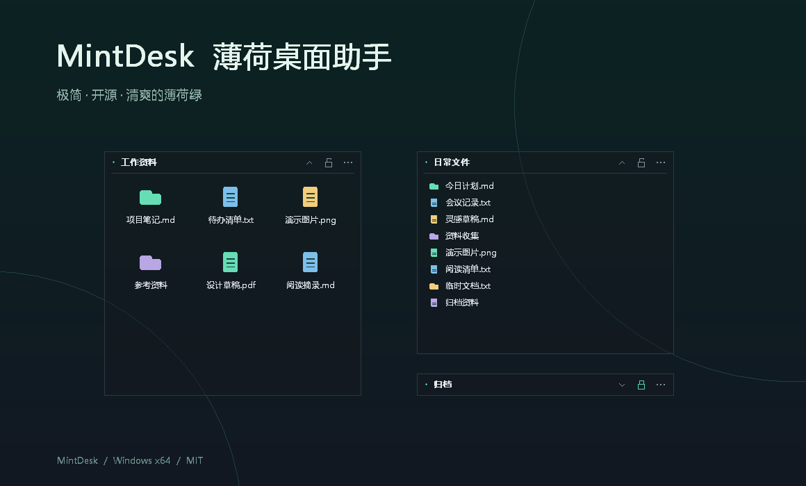

# 薄荷桌面助手 / MintDesk

极简、开源、清爽的薄荷绿。专注桌面整理，持续追求更低的内存与磁盘占用。

[下载最新版](https://github.com/mayflyfy/mint-desk/releases/latest) · [使用说明](docs/usage.md) · [参与开发](CONTRIBUTING.md)

| 轻巧一点 | v0.8.0 Windows x64 |
| --- | --- |
| 单文件 EXE | **仅约 0.42 MB**（409 KiB） |
| ZIP 下载包 | **约 0.20 MB** |
| 运行依赖 | **无需额外依赖或运行库**，解压即用 |
| 内存占用 | 主进程工作集实测 **约 31 MiB**；私有内存约 9 MiB¹ |
| 安静运行 | **无广告、推广和通知弹窗** |
| 隐私 | 无联网服务、无遥测 |
| 自动整理 | 首次打开自动配置开机启动、桌面右键 |
| 系统 | Windows 10 / 11 x64 |
| 开源协议 | MIT · © 2026 MCC |

¹ 本机短时采样，随卡片、文件和系统环境变化；恢复守护与按需权限辅助进程另计。[实测与验证范围](docs/verification.md)

## 常用功能

| 整理 | 操作 |
| --- | --- |
| 列表 / 网格 | 拖入文件、文件夹、快捷方式，双击打开 |
| 拖动排序 | 卡片内排序、跨卡片移动；Ctrl 拖动复制入口 |
| 自由布局 | 缩放、锁定、收起，吸附屏幕和卡片边缘 |
| 薄荷绿外观 | 半透明背景，可用时启用系统毛玻璃 |
| 多屏使用 | 按显示器 DPI 缩放，自动保存布局 |
| 启动与退出 | 自动启动；托盘可关闭自启动、右键入口或退出 |

## 三步开始

1. 下载 ZIP，解压到固定位置，打开 `MintDesk.exe`。
2. 把桌面项目拖入卡片，按喜好排列。
3. 以后登录 Windows 自动启动，恢复上次布局。

桌面原文件保持原路径，收进卡片后临时隐藏，正常退出恢复；隐藏同时影响资源管理器。详见[使用与恢复说明](docs/usage.md)。

程序未签名，Windows 可能显示安全提示；操作受保护项目时可能需要管理员确认。截图使用虚构示例。
