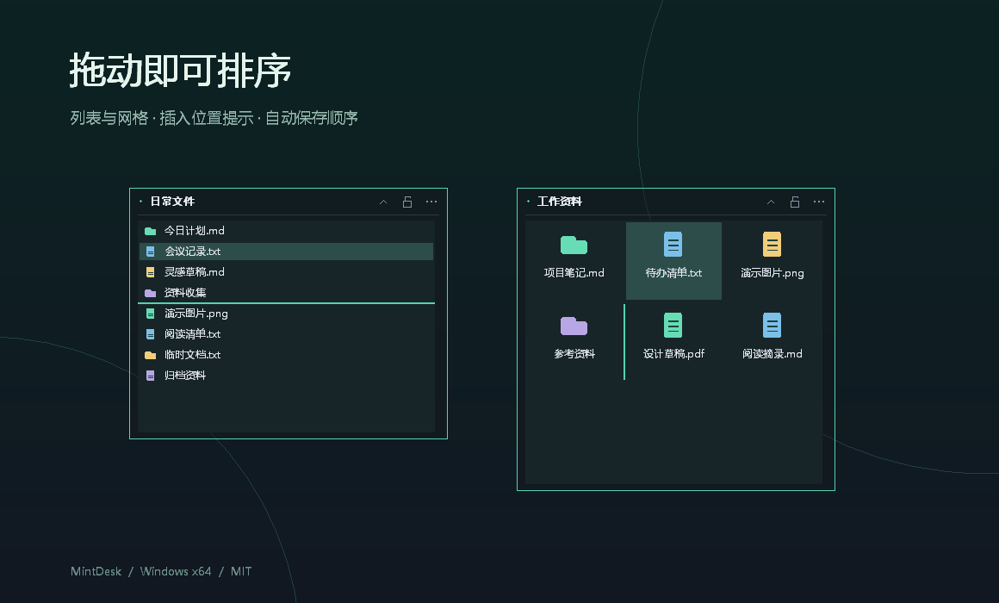

# 薄荷桌面助手 / MintDesk

薄荷桌面助手是一款轻量、安静的 Windows 桌面卡片整理工具。原生 C++17 / Win32，单个便携 EXE，无广告、联网服务、遥测或通知气泡。

A minimal native Windows desktop organizer: compact cards, list/grid views, in-place desktop visibility, and no extra runtime installation.

## 我们的理念

桌面整理应该安静、轻巧，让文件各归其位。薄荷桌面助手坚持极简与开源，用清爽的薄荷绿色呈现清晰、克制的界面。

我们以尽可能低的内存和磁盘占用为持续优化目标，认真对待每一项依赖和每一个常驻功能。功能围绕桌面整理本身展开，只保留真正有用的操作，让软件免安装、打开即用、长期运行也保持轻盈。文件安全与可靠恢复始终是这一取舍的基础。

[下载最新版本](https://github.com/mayflyfy/mint-desk/releases/latest) · [使用与恢复说明](docs/usage.md) · [验证范围](docs/verification.md) · [MIT License](LICENSE)


*使用真实卡片绘制代码与虚构示例生成的隔离演示，背景为示意；不包含真实桌面或已安装软件。*

## 功能

- 紧凑列表与网格；卡片内拖动排序、插入位置提示、边缘滚动，顺序自动保存。
- 卡片间默认移动条目，Ctrl 拖动复制入口；支持拖回桌面及外部文件夹。
- 调整大小、锁定、收起；吸附屏幕边界和相邻卡片，Alt 可临时取消吸附。
- 半透明背景与可用时的系统毛玻璃效果，图标和文字保持原色。
- 保存多卡片布局，按显示器 DPI 缩放，断开显示器后将卡片收回可用区域。
- 首次正常运行自动配置开机启动和桌面右键；之后可在托盘关闭，手动选择会被保留。

Windows 10 / 11 x64。界面使用简体中文。每卡最多 2048 项、共 20000 项，最多 64 张卡片。

## 开始使用

1. 从 [Releases](https://github.com/mayflyfy/mint-desk/releases) 下载 Windows x64 ZIP，解压后运行 `MintDesk.exe`。无需安装其他运行包。
2. 将文件、文件夹或快捷方式拖入卡片，双击条目打开。
3. 拖动标题栏移动卡片；右上角可收起、锁定及打开菜单。双击左上角标题或按 F2 改名。
4. 首次正常运行会加入开机启动并注册桌面右键，以后登录 Windows 自动恢复上次整理。托盘可调整背景、关闭自启动或右键入口及正常退出。

建议先退出其他桌面整理工具，并将解压后的 EXE 保存在固定位置。手动关闭自启动或右键入口后，后续打开不会强制重新启用。Windows 启动项策略也可能阻止自启动。程序未签名，Windows 可能显示安全提示。



## 原文件与安全

**桌面上的直接子项始终保留原路径。** 收进卡片后仅临时设置该项的 Hidden/System 属性；文件夹内部内容不递归修改。桌面以外的文件只保存路径引用。移除最后一个入口、拖回桌面或正常退出时恢复原来的可见性属性。

隐藏期间，资源管理器里也会隐藏该桌面项。软件不修改系统全局显示选项；若用户启用显示受保护系统文件，条目仍可能显示。

修改前先保存两份带 CRC 的恢复记录；恢复时核对文件身份并保留其他属性。无窗口守护进程等待主进程退出后尝试恢复。公共桌面等受保护项目可能请求 Windows 管理员确认，仅受限辅助进程提升权限，界面保持普通权限。

这些措施降低整理操作的风险，不能保证磁盘损坏、外部删除或全部恢复进程同时终止等情况下绝对安全。重要资料应有独立备份。恢复与卸载步骤见 [使用说明](docs/usage.md)。

## 从源码构建

### MinGW-w64

安装 Windows x64 MinGW-w64 后，在项目目录运行：

```powershell
powershell -NoProfile -ExecutionPolicy Bypass -File .\build.ps1
```

也可通过 `-Compiler <g++.exe 的完整路径>` 指定编译器。输出为 `dist/MintDesk.exe`，脚本不下载依赖。

### Visual Studio / CMake

使用 CMake 3.16+ 和 Visual Studio 的 x64 C++ 工具链：

```powershell
cmake -S . -B build-msvc -A x64
cmake --build build-msvc --config Release
```

C++ 运行库静态链接，程序只导入 Windows 系统 DLL。

## 测试、截图与打包

```powershell
powershell -NoProfile -ExecutionPolicy Bypass -File .\tests\run-tests.ps1
powershell -NoProfile -ExecutionPolicy Bypass -File .\tools\render-screenshots.ps1
powershell -NoProfile -ExecutionPolicy Bypass -File .\tools\package-release.ps1
```

测试使用临时文件和隔离预览，不读取个人布局。截图生成器使用虚构文件名与绘制图标。打包采用明确文件清单，不包含个人配置、恢复日志、开发备份或调试产物。发布前可运行 `tools/audit-release.ps1` 扫描待发布文件。

```text
src/                  原生应用与文件恢复实现
assets/               自有图标、清单及图标生成器
tests/                原生回归测试
tools/                演示图、隐私检查与发布包脚本
docs/                 使用说明、验证范围、隔离演示图
.github/workflows/    Windows 构建与测试
```

构建输出和发布包默认不进入 Git；Releases 提供便携 ZIP、EXE 和 SHA-256 校验文件。更多协作说明见 [CONTRIBUTING.md](CONTRIBUTING.md)。

## License

[MIT](LICENSE) · Copyright (c) 2026 **MCC**.
